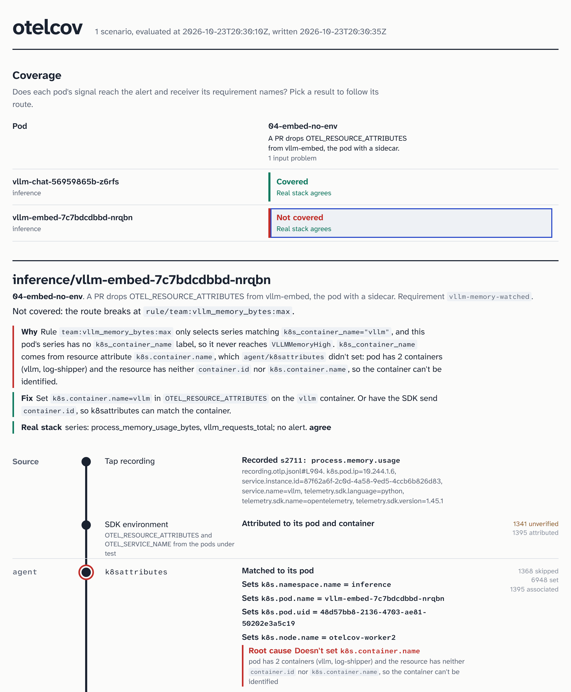

# otelcov

Coverage and lineage for OpenTelemetry monitoring stacks.

otelcov replays recorded telemetry through your collectors, backends, rules, alerts and dashboards to show which workloads are actually watched, explain where coverage breaks, and check pull requests before they merge.

> **Status: early, not production-ready.** Metrics work end to end: recorded OTLP through daemonset agents and a gateway (real collector-contrib processors), Mimir, recording rules, alerts and Alertmanager routing. On a local [kind cluster](dev/kind/) running that stack, otelcov's answers matched what Mimir and Alertmanager actually did: for the baseline, for a gateway pull request predicted before it was deployed, and for the sidecar bug below. It hasn't been pointed at a real staging stack yet, some collector settings aren't modeled yet, and logs, traces and dashboards aren't covered. The design and its decisions live in [AGENTS.md](AGENTS.md).

<picture>
  <source media="(prefers-color-scheme: dark)" srcset="docs/report-page-dark.png">
  
</picture>

*The report page for the sidecar bug, from the kind lab: otelcov's answer per pod, why vllm-embed isn't covered, the fix, and what the real stack did. Below the verdict, the pod's route through the stack, with the root cause ringed.*

## The problem

Monitoring breaks silently, often in a layer nobody touched.

A real example: an alert watched vLLM pods through a recording rule that selects `k8s_container_name="vllm"`. Someone added a log-shipper sidecar to one of the pods. The OpenTelemetry `k8sattributes` processor can only name the container when a pod has exactly one, so that pod's metrics lost their container label. The rule stopped matching them, and the alert stopped watching the pod. Nobody edited the alert or the rule, nothing failed, and nothing said so.

Existing tools each check one layer: collector configs, rule syntax, whether metrics exist. None follows a single workload's telemetry through the whole stack.

## How it works

otelcov models the monitoring stack as one graph:

```
apps → collectors (agent, gateway) → backends (Mimir, Loki) → recording rules → alerts → Alertmanager routes → receivers
                                                          └→ dashboards
```

- **Recorded data, real code.** A tap in your staging collectors records the telemetry they receive. otelcov replays it through the graph, running the real Prometheus engine, Alertmanager routing and collector processor code wherever it can.
- **Every node is `f(data, config)`.** To check a pull request, keep the recorded data and swap in the PR's config: pod specs, collector config, rules, routes.
- **Coverage, per workload.** You state requirements in OpenTelemetry terms, e.g. "every vLLM pod's memory must reach `VLLMMemoryHigh`, which pages the inference team". otelcov reports, for each pod, whether a path exists.
- **Lineage that explains the break.** When a path breaks, the report follows it back to the root cause, including things that *didn't* happen (see Usage).
- **Honest about limits.** Anything otelcov can't model or attribute is reported as `unverified`, never guessed.

## Usage

otelcov runs *scenarios*: a snapshot (the recordings, one per tapped collector instance, and what was running when they were made), the config under test (pods, and a topology file naming the collector, Mimir, rules and Alertmanager configs and how they connect) and coverage requirements.

The collectors' processors are modeled by a stage plugin, a separate binary for the collector distribution and version (`otelcov-plugin-otelcol-contrib`, built against collector-contrib 0.139 and reviewed for collectors 0.134 to 0.139). otelcov looks for plugins next to its own binary, so build both into one directory:

```console
$ go build -o bin/ ./cmd/...
$ bin/otelcov version
otelcov v0.0.0-…
plugin otelcov-plugin-otelcol-contrib: models otelcol-contrib 0.139.0, reviewed for 0.134–0.139 (collector-contrib v0.139.0, pdata v1.45.0)
```

```console
$ bin/otelcov scenario testdata/thin-slice/scenarios/02-sidecar-added.yaml
02-sidecar-added (evaluated at 2026-10-23T10:00:30Z)
  warning: mimir-otlp: answers assume the tenant stays within Mimir's rate, series, sample-time, query and rule limits, which a replay can't check
  covered (modelled)      inference/vllm-chat-6f9d8b7c4d-k2x7p  [vllm-memory-watched]
      path: s1 → p1 → r1 → a1 → inference-pager
      modelled: collector/batch (approximation: passes data through)
  NOT COVERED             inference/vllm-embed-5c8b9d6f7b-q4m9t  [vllm-memory-watched]
      path: s2 → p2 ✗ rule/inference:vllm_memory_bytes:max
      why: Rule `inference:vllm_memory_bytes:max` only selects series matching `k8s_container_name="vllm"`, and this pod's series has no `k8s_container_name` label, so it never reaches `VLLMMemoryHigh`. `k8s_container_name` comes from resource attribute `k8s.container.name`, which `collector/k8sattributes` didn't set: pod has 2 containers (vllm, log-shipper) and the resource has neither `container.id` nor `k8s.container.name`, so the container can't be identified.
      fix: Set `k8s.container.name=vllm` in `OTEL_RESOURCE_ATTRIBUTES` on the `vllm` container.
      fix: Or have the SDK send `container.id`, so k8sattributes can match the container.
```

An answer is only as sure as the steps it depends on. Where those are the real components' code (the collector's own processors, Prometheus's rule engine, Alertmanager's routing) or a model that passes tests against the real component, the answer is plain "covered" or "NOT COVERED". Two models of otelcov's own are tested that way: k8sattributes against upstream's test cases, and the Mimir model (Prometheus's OTLP translator set up like Mimir) against real Mimir 3.0 and 3.2, for topologies that give a Mimir version in that range. Where an answer depends on an approximation or an untested model, it says "(modelled)" and lists them: here batch, which otelcov passes data through without batching. Where it depends on a step otelcov can't model at all, it's `unverified`.

Processors explain themselves too. Here a pull request changes the condition of a gateway `transform` statement, and the rule's `team="inference"` matcher loses both pods:

```console
$ bin/otelcov scenario testdata/agent-gateway/scenarios/02-team-condition-pr.yaml
02-team-condition-pr (evaluated at 2026-10-23T10:00:30Z)
  warning: mimir: answers assume the tenant stays within Mimir's rate, series, sample-time, query and rule limits, which a replay can't check
  NOT COVERED             inference/vllm-chat-6f9d8b7c4d-k2x7p  [vllm-memory-watched]
      path: s1 → p1 ✗ rule/team:vllm_memory_bytes:max
      why: Rule `team:vllm_memory_bytes:max` only selects series matching `team="inference"`, and this pod's series has no `team` label, so it never reaches `VLLMMemoryHigh`. `team` comes from resource attribute `team`, which `gateway/transform/team` didn't set: resource statement `set(attributes["team"], "inference") where attributes["k8s.namespace.name"] == "inference-prod"` didn't run: its condition is false for this signal.
      fix: Make the condition `attributes["k8s.namespace.name"] == "inference-prod"` in `gateway/transform/team` hold for this pod, or set `team` another way.
  ...
```

Mimir configs work as deployed. otelcov reads the limits section and, when the topology names them, the runtime config file and the tenant whose overrides apply. Every Mimir 3.0–3.2 limit is sorted by what it can do to coverage. Limits that can't change it are ignored. Rate, series and timing limits, which a replay can't see, are assumed met, and the warning above says so. A limit that changes what's stored or how rules run, and that otelcov doesn't model (such as `drop_labels`), makes answers through Mimir `unverified` and names the limit.

The topology file is checked on every run: an exporter sending to the wrong port, a receiver listening on localhost only, or an exporter that isn't connected to anything is reported, and coverage through it is marked `unverified` or the run stops.

`-json` prints the full report, with every signal and lineage event. `-html report.html` writes one self-contained page for all the scenarios: a coverage matrix, and for any pod its route through the stack, with what each node did to its signal and where the route breaks. The exit status is 1 when anything is not covered, modelled or not, so it can gate CI.

## Try it on a cluster

[`dev/kind/`](dev/kind/) runs daemonset agents, a gateway, Mimir and Alertmanager on a local kind cluster with Tilt. You capture what the agents record, run otelcov on it, and compare its answers with what Mimir and Alertmanager really did, including for a pull request you then deploy.

## Scope

The first release targets one concrete stack: OpenTelemetry Collector daemonset agents and a gateway, Mimir and Loki, Prometheus-style rules, Alertmanager and Grafana dashboards. Everything is built as adapters behind generic interfaces, so other backends and deployment patterns can follow.

## Related tools

otelcov builds on ideas from several tools that each cover part of the problem: Bindplane's snapshot recordings, Elastic's OTTL Playground, OpenTelemetry Weaver's live-check, `mimirtool analyze`, `pint` and `promtool`. See [AGENTS.md](AGENTS.md#prior-art) for how they compare.

## Contributing

The project is at an early stage. Read [AGENTS.md](AGENTS.md) first: it holds every design decision so far, the alternatives considered, and the open questions. Issues and discussion are welcome.

## License

[Apache-2.0](LICENSE)
